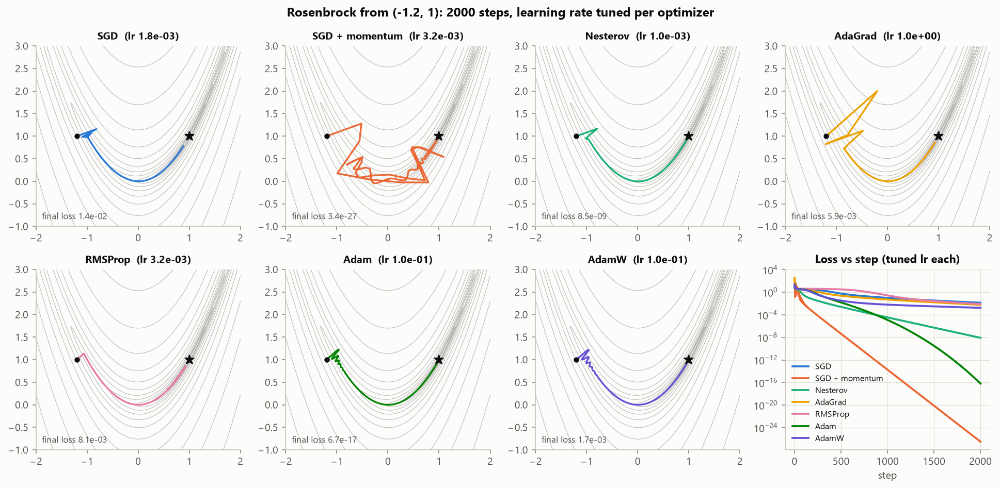
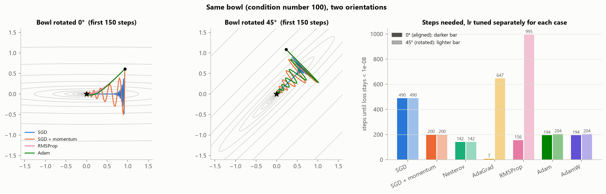
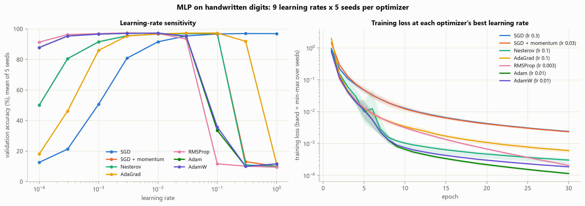
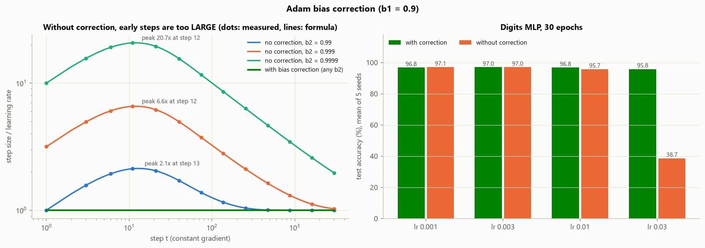
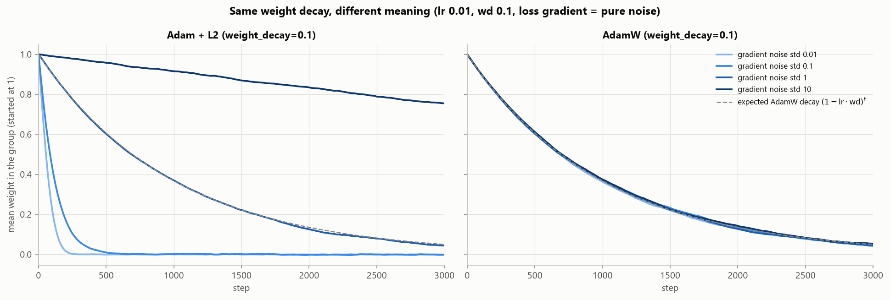

# Optimizers from Scratch

Seven gradient-descent optimizers are written from scratch in NumPy: SGD, momentum, Nesterov, AdaGrad, RMSProp, Adam (with AMSGrad) and AdamW. Each one is **verified step by step against PyTorch**. They are then compared in five experiments, and each experiment tests one idea about *why* they behave the way they do.

No autograd and no deep-learning framework: the optimizers are about 200 lines of NumPy, and the test network has hand-written backpropagation (checked against finite differences).

## Key results

| | Finding | Evidence |
|---|---|---|
| ✅ | **The implementations are exact.** 13 configurations match `torch.optim` to within 1e-10 over 200 steps. The test is sensitive enough to catch an `eps` change from 1e-8 to 1e-7. | `tests/test_vs_torch.py` |
| 🎯 | **Tuning the learning rate matters more than choosing the optimizer.** On a digits MLP, with the learning rate tuned on validation data, all seven reach **96.4–97.1 %** test accuracy, within seed noise. What changes is *where* the good learning rate is: 0.3 for SGD, 0.01 for Adam, 0.003 for RMSProp. | Experiment 3 |
| 🔁 | **Momentum with β = 0.9 behaves like SGD with a 10× learning rate.** SGD at lr 0.3 and momentum at lr 0.03 trace almost the same loss curve, since 1/(1−β) = 10. | Experiment 3 |
| 🔄 | **Adaptive methods are not rotation-invariant.** AdaGrad needs **7 steps** on an axis-aligned bowl and **647** on the same bowl rotated 45°. RMSProp goes from 156 to 995 steps. SGD, momentum and Nesterov give identical curves (to 1e-11). | Experiment 2 |
| ⚠️ | **Adam's bias correction prevents *overshoot*, not undershoot.** Without it, early steps are up to **6.6×** too large (20.7× with β₂ = 0.9999). At lr 0.03, the MLP's test accuracy falls from 95.8 % to **38.7 %**. | Experiment 4 |
| ⚖️ | **AdamW ≠ Adam + L2.** With L2 inside Adam, weights with large gradients barely decay (75 % left after 3,000 steps) while weights with small gradients are wiped out. AdamW decays every weight at the same rate. | Experiment 5 |

## What's in the repo

```
fromscratch/
  optim.py        SGD (momentum, Nesterov, dampening, weight decay), AdaGrad, RMSProp (centered,
                  momentum), Adam (AMSGrad, L2 or decoupled decay, optional bias correction), AdamW
  mlp.py          multilayer perceptron with hand-written forward and backward passes
  functions.py    2-D test functions with analytic gradients (Rosenbrock, rotated quadratic bowl)
  data.py         scikit-learn's 8x8 digits (bundled, no download), 60/20/20 train/val/test split
tests/
  test_vs_torch.py     every optimizer vs torch.optim, step by step, float64
  test_gradcheck.py    backprop vs finite differences
  test_optim_basic.py  convergence, input checks, closed forms, stability limits
experiments/      the five experiments below; each saves a figure and a JSON of its numbers
figures/, results/
```

Using it:

```python
from fromscratch import MLP, Adam

model = MLP([64, 128, 64, 10])
opt = Adam(model.params, lr=1e-2)          # params are NumPy arrays, updated in place

loss, grads = model.loss_and_grads(X_batch, y_batch)
opt.step(grads)
```

## The update rules

Notation: $g_t$ is the gradient at step $t$, $\eta$ the learning rate, and all operations are element-wise.

| Optimizer | Update |
|---|---|
| SGD | $\theta \leftarrow \theta - \eta\, g_t$ |
| Momentum (heavy ball) | $b_t = \mu b_{t-1} + g_t, \quad \theta \leftarrow \theta - \eta\, b_t$ |
| Nesterov | $b_t = \mu b_{t-1} + g_t, \quad \theta \leftarrow \theta - \eta\,(g_t + \mu b_t)$ |
| AdaGrad | $s_t = s_{t-1} + g_t^2, \quad \theta \leftarrow \theta - \eta\, g_t / (\sqrt{s_t} + \epsilon)$ |
| RMSProp | $v_t = \alpha v_{t-1} + (1-\alpha) g_t^2, \quad \theta \leftarrow \theta - \eta\, g_t / (\sqrt{v_t} + \epsilon)$ |
| Adam | $m_t = \beta_1 m_{t-1} + (1-\beta_1) g_t,\ \ v_t = \beta_2 v_{t-1} + (1-\beta_2) g_t^2,\ \ \hat m_t = \dfrac{m_t}{1-\beta_1^t},\ \ \hat v_t = \dfrac{v_t}{1-\beta_2^t},\ \ \theta \leftarrow \theta - \eta\, \dfrac{\hat m_t}{\sqrt{\hat v_t} + \epsilon}$ |
| AdamW | $\theta \leftarrow \theta\,(1 - \eta\lambda)$, then the Adam step on $g_t$ alone |

Adam with L2 instead adds $\lambda\theta$ to $g_t$, so the decay term is also divided by $\sqrt{\hat v_t}$. Experiment 5 shows why that matters.

## Experiment 1: the Rosenbrock valley

`python -m experiments.rosenbrock`

Rosenbrock, $f(x,y) = (1-x)^2 + 100(y-x^2)^2$, has a long, curved, flat-bottomed valley. Each optimizer gets 2,000 steps from (−1.2, 1), with the learning rate chosen by grid search (21 values from 1e-5 to 1).



| Optimizer | Tuned lr | Loss after 2,000 steps | Steps to loss < 1e-3 |
|---|---|---|---|
| SGD | 1.8e-3 | 1.4e-2 | not reached |
| SGD + momentum | 3.2e-3 | 3.4e-27 | 164 |
| Nesterov | 1.0e-3 | 8.5e-9 | 604 |
| AdaGrad | 1.0 | 5.9e-3 | not reached |
| RMSProp | 3.2e-3 | 8.1e-3 | not reached |
| Adam | 0.1 | 6.7e-17 | 715 |
| AdamW | 0.1 | 1.7e-3 | not reached |

**Why:**

- **The tuned learning rates sit just under each method's stability limit.** At the minimum, the Hessian's largest eigenvalue is λ ≈ 1002. On a quadratic, SGD is stable only when ηλ < 2, heavy-ball momentum when ηλ < 2(1+μ) = 3.8, and Nesterov when ηλ < 2(1+μ)/(1+2μ) ≈ 1.36. That gives limits of 2.0e-3, 3.8e-3 and 1.4e-3, just above the tuned values. These limits are checked in `tests/test_optim_basic.py`.
- **SGD is stuck with a step size that is tiny for the flat direction.** The curvature along the valley floor is about 2,500× smaller than across it, and SGD has to keep its step small enough for the steep direction. Momentum gets around this by accumulating speed along the floor.
- **AdamW settles slightly off the minimum.** That is not a bug: its default weight decay (0.01) keeps pulling the parameters towards 0, and on this problem there is nothing to regularise.

## Experiment 2: adaptive methods are not rotation-invariant

`python -m experiments.rotation`

The setup is one quadratic bowl with condition number 100, in two orientations: aligned with the axes, and rotated 45°. The start point is rotated with it, so the two problems are the same problem in different coordinates. The learning rate is tuned separately for every case.



**What it shows:**

- **SGD, momentum and Nesterov:** the same number of steps in both orientations (490, 200, 142). Their loss curves match to a relative error of 1e-11. Their updates are built only from the gradient vector, which rotates with the problem.
- **AdaGrad, RMSProp and Adam:** each scales every coordinate by its own $1/\sqrt{v}$, which works as a *diagonal* preconditioner. A diagonal preconditioner can undo ill-conditioning only when it lines up with the axes. So AdaGrad goes from 7 steps to 647, and RMSProp from 156 to 995.
- **Adam's step count barely changes (194 → 204).** Its best learning rate moves 30×, though (0.018 → 0.56). Finding out exactly why is a good next ablation: for example, Adam with β₁ = 0.

The general lesson: per-parameter learning rates help most when the important directions line up with individual parameters. That is one common explanation for why adaptive methods do well on sparse or differently scaled features.

## Experiment 3: training a network (digits MLP)

`python -m experiments.digits`

The network is an MLP (64 → 128 → 64 → 10, ReLU) trained on 1,797 8×8 handwritten digits for 30 epochs with batch size 64. Each optimizer is run at 9 learning rates (1e-4 to 1) with 5 seeds each, which is 315 runs. The learning rate is chosen on validation accuracy, and test accuracy is reported only for that choice.



| Optimizer | Best lr | Val acc | Test acc (mean ± std, 5 seeds) | Final train loss |
|---|---|---|---|---|
| SGD | 0.3 | 97.0 % | 96.8 ± 0.5 % | 2.4e-3 |
| SGD + momentum | 0.03 | 97.0 % | 96.7 ± 0.7 % | 2.3e-3 |
| Nesterov | 0.1 | 97.0 % | 96.4 ± 0.8 % | 3.0e-4 |
| AdaGrad | 0.1 | 97.3 % | 96.6 ± 0.6 % | 6.0e-4 |
| RMSProp | 0.003 | 97.4 % | **97.1 ± 0.5 %** | 2.1e-4 |
| Adam | 0.01 | 97.3 % | 96.8 ± 0.9 % | **1.1e-4** |
| AdamW | 0.01 | 97.3 % | 96.8 ± 0.8 % | 1.9e-4 |

**What it shows:**

- **Once tuned, the optimizers are statistically tied on test accuracy.** All seven are within one standard deviation of each other.
- **Adam, AdamW and RMSProp drive the *training* loss about 10× lower** than SGD and momentum (1–2e-4 vs 2.3e-3), but on this dataset that doesn't turn into better test accuracy.
- **Each optimizer has a usable window about one decade wide** (3 of the 9 grid points within 1 point of its best). What differs is *where* the window sits:
  - SGD: 0.1–1
  - momentum, Nesterov and AdaGrad: 0.01–0.1
  - RMSProp, Adam and AdamW: 0.001–0.01
- **SGD at lr 0.3 and momentum at lr 0.03 give nearly the same training curve.** With a small learning rate, heavy-ball momentum is close to SGD with a learning rate of η/(1−μ) = 10η.
- **Below lr 0.1, momentum's accuracy curve is SGD's shifted by exactly one decade.** Momentum gives 91.6 % at 1e-3 and SGD gives 91.6 % at 1e-2; one step up, it is 95.5 % vs 95.4 %. The same 10× is why momentum diverges at learning rates SGD handles fine.

## Experiment 4: why Adam needs bias correction

`python -m experiments.adam_bias_correction`

$m$ and $v$ start at zero. With a constant gradient $g$, after $t$ steps $m_t = (1-\beta_1^t)\,g$ and $v_t = (1-\beta_2^t)\,g^2$. Without correction, the step is therefore

$$\eta\,\frac{m_t}{\sqrt{v_t}} = \eta\,\frac{1-\beta_1^t}{\sqrt{1-\beta_2^t}}$$

That is larger than $\eta$, because $\beta_2$ is closer to 1 than $\beta_1$, so $v$ is *more* biased towards zero than $m$. With the defaults it is 3.2η at step 1 and peaks at **6.6η at step 12**. With correction, the step is exactly η.



- **Left:** the optimizer's measured step (dots) matches the formula (lines) for three values of β₂.
- **Right:** on the MLP, removing the correction makes no difference at small learning rates. At lr 0.03, the early overshoot wrecks training: test accuracy falls from 95.8 % to 38.7 %, averaged over 5 seeds.

## Experiment 5: AdamW vs Adam + L2

`python -m experiments.adamw_vs_l2`

This setup isolates the effect. There are four groups of 2,000 weights, all starting at 1. Their loss gradients are pure zero-mean noise, so only weight decay moves them on average. The groups differ only in gradient size (noise std 0.01, 0.1, 1, 10). The settings are lr 0.01 and decay 0.1.



Mean weight after 3,000 steps:

| Noise std | Adam + L2 | AdamW |
|---|---|---|
| 0.01 | 0.00 | 0.04 |
| 0.1 | 0.00 | 0.04 |
| 1 | 0.04 | 0.05 |
| 10 | **0.75** | 0.05 |

The expected AdamW value is (1 − lr·wd)^3000 = 0.050.

**Why:**

- **With L2, the decay term λθ is part of the gradient**, so Adam divides it by $\sqrt{\hat v}$, which is roughly the gradient size.
- **Weights with large gradients get almost no decay.** Weights with tiny gradients get a full-size step of about η per step towards zero, regardless of λ.
- **AdamW applies the decay outside the adaptive scaling**, so every weight shrinks by the same factor.
- **The two agree only when the gradient scale is about 1** (the std = 1 row). This is the argument of Loshchilov & Hutter (2019).

## Run it

```bash
pip install -r requirements.txt
pip install torch --index-url https://download.pytorch.org/whl/cpu   # only for the PyTorch comparison tests

python -m pytest                    # 32 tests (13 compare against PyTorch)
python -m experiments.run_all       # regenerates figures/ and results/ in about 2 minutes on a laptop CPU
```

## Limitations

- **The problems are small** (2-D functions and a 1,797-image dataset) so that everything runs on a CPU in minutes. They test mechanisms. They don't say which optimizer is best for large networks.
- **The learning rates are fixed**, with no schedules, warm-up or gradient clipping. Learning rates are tuned on a half-decade grid.
- **Each digits result is averaged over 5 seeds.** Differences under about 1 point are within noise, and the README says so wherever it matters.

## References

- Duchi, Hazan, Singer (2011). *Adaptive Subgradient Methods for Online Learning and Stochastic Optimization* (AdaGrad).
- Hinton (2012). *Neural Networks for Machine Learning*, Lecture 6e (RMSProp).
- Sutskever, Martens, Dahl, Hinton (2013). *On the importance of initialization and momentum in deep learning*.
- Kingma, Ba (2015). *Adam: A Method for Stochastic Optimization*.
- Reddi, Kale, Kumar (2018). *On the Convergence of Adam and Beyond* (AMSGrad).
- Loshchilov, Hutter (2019). *Decoupled Weight Decay Regularization* (AdamW).
- PyTorch `torch.optim` source, used as the reference implementation for the tests.
